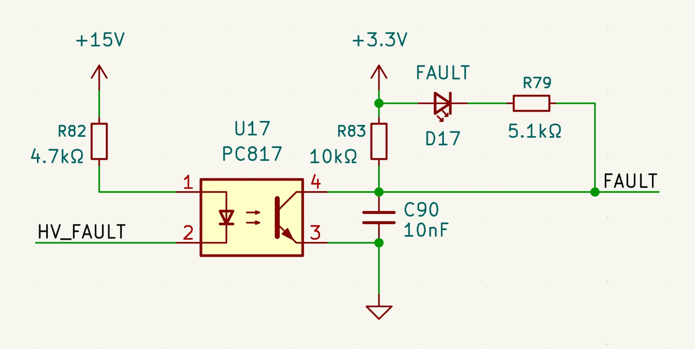
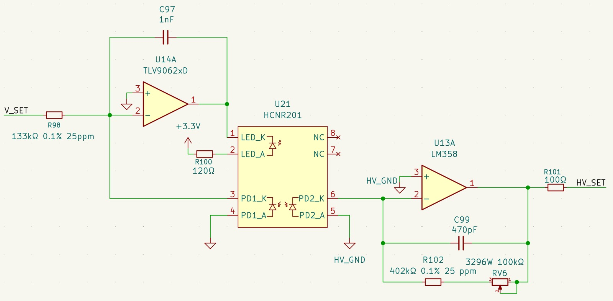
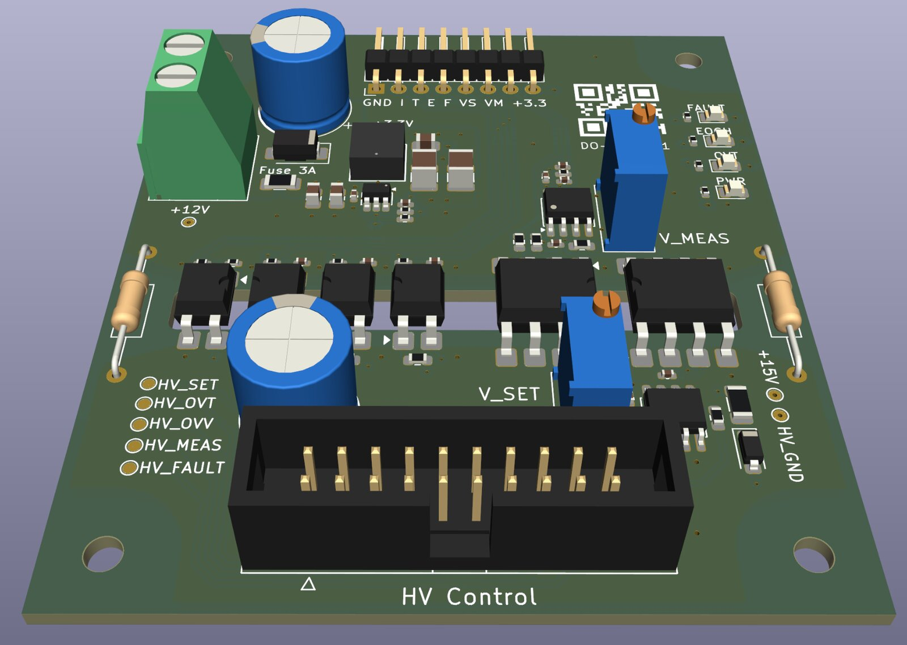
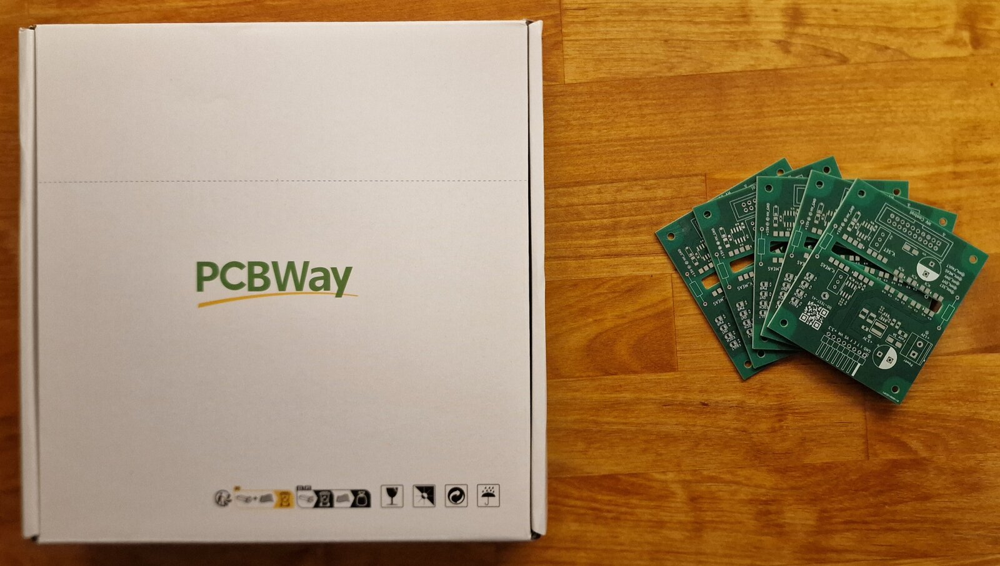
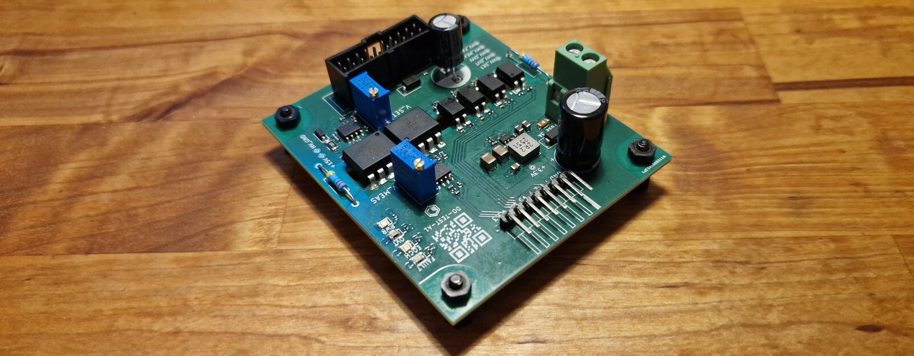

# opto-board

A small isolated interface board that lets a microcontroller set and read analog voltages and exchange digital ON/OFF signals with a separate high-voltage domain. Nothing connects the two sides except the optocouplers, so ground loops and interference stay out of the low-voltage electronics. The board is designed in KiCad and was built as a test fixture.

## Schematic

The board has two kinds of channels across the isolation barrier.

**Digital (4 × PC817).** These carry ON/OFF signals, such as an active-low fault input. On the HV side, a 4.7 kΩ pull-up to +15 V drives the LED with about 2.9 mA. On the LV side, the phototransistor pulls a 10 kΩ pull-up to 3.3 V low, and a 10 nF capacitor filters short spikes. That only needs a CTR of about 19 %, well under the 50 % the PC817 guarantees. In the MCU → HV direction, the MCU pin sources the LED current, so an unpowered MCU leaves the output in a safe state.

**Analog (2 × HCNR201).** These carry 0–3.3 V on the MCU side and 0–10 V on the HV side, in both directions: one channel sets a voltage and one measures it. Each HCNR201 has one LED and two matched photodiodes. An op-amp servo loop drives the LED so that the input photodiode current equals V_IN / R_IN. This cancels out LED drift from temperature, part spread and aging. On the other side, a transimpedance amplifier turns the output photodiode current back into a voltage:

V_OUT / V_IN = K3 · R_OUT / R_IN

K3 differs from part to part, so R_OUT includes a trimmer and each channel is calibrated once. The full-scale photodiode current of about 25 µA sits in the linear range of the HCNR201, where the datasheet specifies 0.05 % nonlinearity.

The LV side runs from 12 V through a fuse, a TVS diode and a buck converter that makes 3.3 V. The HV side is powered from the +15 V auxiliary output of the device being controlled. A 10 MΩ bleed (2 × 20 MΩ) connects HV_GND to GND so the HV ground cannot float to an arbitrary voltage.

## Board layout

| | |
|---|---|
| Size | 65 × 75 mm, 1.6 mm FR-4, 4 layers |
| Isolation slot | 55 × 5 mm, milled through the board |
| Copper-free gap | 9 mm between domains on every layer, including the inner planes |
| Narrowest point | PC817 package, 7.62 mm between the pad rows |
| Indicators | PWR, FAULT, OVT and EOCH LEDs on the LV side |

No copper from one domain runs under the other one on any layer. The slot forces surface creepage to go around it instead of straight across. This is a test board: the spacing is a design target, not a certified isolation rating.

## PCB production

[PCBWay](https://www.pcbway.com/) manufactured the PCBs as part of a sponsorship. 

The isolation slot was milled cleanly, there were no solder mask, copper or via defects, and the matte solder mask made hand soldering easy. The board worked on the first try and did the job!

## Results

In a loopback test (setpoint output wired to the measurement input, 2360 readings), the gain error was −0.13 % and 94 % of readings fell within one 8-bit step of the setpoint. Each channel behaves like a low-pass filter of about 1 kHz, and the full loopback settles in about 1.5 ms.
